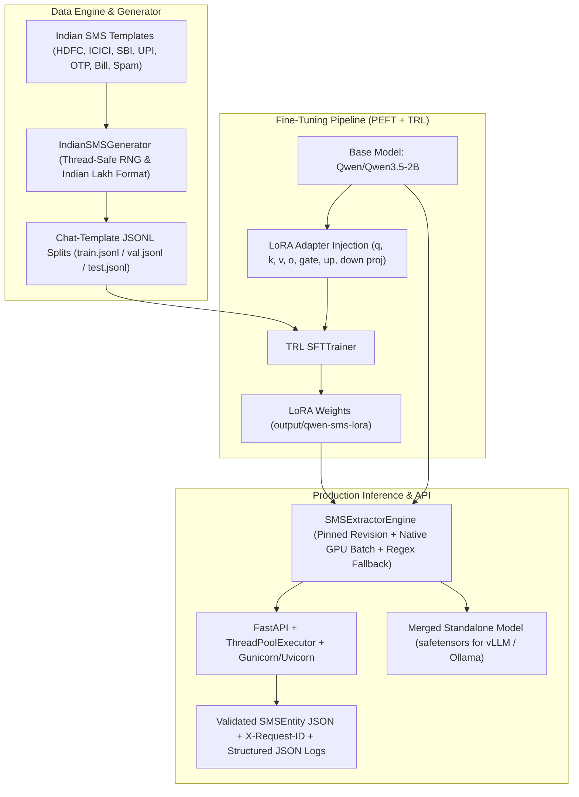

# 🇮🇳 SLM-SMS: Indian SMS Entity Extraction & Fine-Tuning

[](https://python.org)
[](https://github.com/astral-sh/uv)
[](https://huggingface.co)
[](https://fastapi.tiangolo.com)

An end-to-end Small Language Model (SLM) pipeline to fine-tune **Qwen3.5 2B** (with **Qwen2.5** support) for structured JSON entity extraction from Indian SMS messages—covering banking debits/credits, UPI payments, OTPs, bill due notices, and spam/phishing detection.

Includes **both** an interactive **Jupyter Notebook** and a production-ready **Python package, CLI, and FastAPI/Gunicorn microservice**.

---

## 📌 Table of Contents

- [Architecture Overview](#️-architecture-overview)
- [Key Features](#-key-features)
- [Project Directory Structure](#-project-directory-structure)
- [Quickstart with UV](#-quickstart-with-uv)
- [Configuration & Environment Variables](#️-configuration--environment-variables)
- [Indian SMS Synthetic Corpus Generator](#-indian-sms-synthetic-corpus-generator)
- [Model Fine-Tuning Pipeline](#-model-fine-tuning-pipeline)
- [Evaluation & Benchmarking](#-evaluation--benchmarking)
- [Interactive Jupyter Notebook](#-interactive-jupyter-notebook)
- [Single SMS CLI Inference](#-single-sms-cli-inference)
- [Production Serving with FastAPI & Gunicorn](#-production-serving-with-fastapi--gunicorn)
- [Observability (OpenTelemetry)](#-observability-opentelemetry)
- [LoRA Weight Merging & Export](#-lora-weight-merging--export)
- [Testing, Coverage, Linting & Load Testing](#-testing-coverage-linting--load-testing)

---

## 🏗️ Architecture Overview



---

## ✨ Key Features

- **Fast Package Management with `uv`**: Deterministic environment and lockfile (`pyproject.toml` + `uv.lock`) targeting Python `3.12` (`>=3.12, <3.13`).
- **Qwen Fine-Tuning via PEFT + TRL**: Default `Qwen/Qwen3.5-2B` (plus `Qwen/Qwen2.5-1.5B-Instruct`, `3B`, `0.5B` configs in `config/train_config.yaml`) with 4-bit/8-bit QLoRA on CUDA, `float16` on Apple Silicon MPS, and CPU fallback.
- **Domain-Specific Indian SMS Synthesizer (`IndianSMSGenerator`)**:
  - Covers 10 Indian banks (`VM-HDFCBK`, `AD-ICICIB`, `BZ-SBIINB`, `AX-AXISBK`, `VK-KOTAKB`, etc.), 32 merchants/VPAs, 7 UPI apps, OTPs, utility/credit-card bills, and spam/phishing messages.
  - **True Indian Number Formatting**: Formats currency using Indian lakh/crore grouping (`1,45,000.00`, `14,50,000.00`).
  - **Thread-Safe Reproducibility**: Uses an isolated `random.Random(seed)` instance per generator instead of global RNG state.
  - **Class Imbalance Guard**: Logs class distribution during dataset generation and raises an error if any class falls below `min_class_fraction` (default `0.02`).
- **Resilient Inference Engine (`SMSExtractorEngine`)**:
  - Uses Hugging Face revision pinning (`SLM_MODEL_REVISION`) to guard against unpinned `trust_remote_code` supply-chain drift.
  - `extract_batch()` uses native left-padded batched GPU generation rather than sequential loops.
  - Automatic deterministic regex fallback when model weights are unavailable or generation fails schema parsing, without leaking raw LLM output in API responses.
- **Production FastAPI Microservice**:
  - Lifespan-managed single engine initialization in `app.state.engine` (eliminates lazy-init race conditions).
  - Non-blocking inference offloaded to a configurable `ThreadPoolExecutor` (`SLM_INFERENCE_THREADS`).
  - Strict Pydantic input limits (`1–480` characters per SMS; `1–50` items per batch request).
  - Split Kubernetes probes (`/health/live` vs `/health/ready`) and graceful shutdown draining (`SLM_DRAIN_SECONDS`).
  - Centralized JSON logging (`slm_sms.core.logging`) and `X-Request-ID` middleware across all requests.
  - Ready-to-run `gunicorn.conf.py` using `UvicornWorker`.
- **Observability with OpenTelemetry**:
  - End-to-end distributed tracing (FastAPI ASGI -> `ThreadPoolExecutor` context propagation -> `SMSExtractorEngine` / `SMSTrainingPipeline`) with W3C `traceparent`/`baggage` propagation and `X-Trace-ID` response headers.
  - Domain & GenAI OTel metrics (`slm.inference.requests`, `slm.inference.duration`, `slm.inference.batch_size`, `slm.inference.tokens.input`, `slm.inference.tokens.output`, `slm.inference.fallback.total`, `slm.engine.ready`) exported via OTLP (HTTP/protobuf or gRPC) or Console.
  - Centralized JSON logging (`slm_sms.core.logging`) with automatic `trace_id` / `span_id` / `trace_flags` correlation and strict PII exclusion from telemetry attributes.
- **Quality & Load Testing**:
  - Tiered unit, HTTP integration, and OpenTelemetry tests (`tests/unit/`, `tests/integration/`) with `pytest-cov` (`--cov-fail-under=60`), Ruff linting/formatting, and `tests/load/locustfile.py`.

---

## 📂 Project Directory Structure

```text
SLMTraining/
├── pyproject.toml                        # UV project definition, scripts, Ruff, Pytest & Coverage config
├── uv.lock                               # Locked dependency graph
├── Makefile                              # Common dev/test/lint/serve/load-test tasks
├── gunicorn.conf.py                      # Production Gunicorn + UvicornWorker configuration
├── .env.example                          # Documented environment variable template
├── .gitignore                            # Ignores .venv, .env, output/, models/, .coverage, htmlcov/
├── README.md                             # Project documentation
├── config/
│   ├── generation_config.yaml            # Synthetic corpus distribution settings
│   └── train_config.yaml                 # Base model, LoRA, and SFTTrainer hyperparameters
├── src/
│   └── slm_sms/
│       ├── __init__.py
│       ├── py.typed                      # PEP 561 typed package marker
│       ├── cli.py                        # Typer CLI (`slm-sms` and subcommand entry points)
│       ├── core/                         # Cross-cutting infrastructure
│       │   ├── __init__.py
│       │   ├── config.py                 # Centralized Settings singleton & YAML config loader
│       │   ├── logging.py                # Centralized JSON/text logging with OTel trace correlation
│       │   └── telemetry.py              # OpenTelemetry tracing, metrics, OTLP export, & FastAPI setup
│       ├── data/
│       │   ├── __init__.py
│       │   ├── schema.py                 # Pydantic SMSEntity, TransactionType, & SMSChatSample models
│       │   ├── generator.py              # Thread-safe Indian SMS synthetic data generator
│       │   └── dataset.py                # JSONL I/O & Hugging Face DatasetDict loader
│       ├── models/
│       │   ├── __init__.py
│       │   └── model_loader.py           # Device detection, revision-pinned HF loaders, PEFT LoRA setup
│       ├── training/
│       │   ├── __init__.py
│       │   ├── trainer.py                # TRL SFTTrainer pipeline (CUDA/MPS/CPU precision aware)
│       │   └── metrics.py                # ExtractionMetricsReport (JSON validity, field accuracy, spam F1)
│       └── inference/
│           ├── __init__.py
│           ├── engine.py                 # SMSExtractorEngine (single, batched GPU, regex fallback)
│           └── server.py                 # FastAPI microservice with probes, validation, & request IDs
├── scripts/
│   ├── generate_data.py                  # Standalone data generation script
│   ├── train.py                          # Standalone fine-tuning script
│   ├── evaluate.py                       # Standalone test-set evaluation script
│   ├── inference.py                      # Single SMS CLI inference script
│   ├── serve.py                          # Uvicorn server runner (loads .env)
│   └── export_merged_model.py            # Merges LoRA weights into base model for vLLM / Ollama
├── tests/
│   ├── conftest.py                       # Shared offline-safe pytest fixtures
│   ├── unit/
│   │   ├── test_config.py                # Settings & YAML config loading tests
│   │   ├── test_schema.py                # Schema cleaning & JSON markdown extraction tests
│   │   ├── test_generator.py             # Generator splits, Indian number formatting, RNG & balance tests
│   │   ├── test_inference.py             # Regex fallback, metrics, and health endpoint tests
│   │   ├── test_telemetry.py             # OpenTelemetry trace, metric, PII, & log-correlation tests
│   │   └── test_trainer.py               # SFTTrainer setup test
│   ├── integration/
│   │   └── test_server_integration.py    # End-to-end FastAPI validation, probes, & request-ID tests
│   └── load/
│       └── locustfile.py                 # Locust load testing suite
├── notebooks/
│   └── qwen_sms_fine_tuning.ipynb        # Interactive end-to-end training & testing notebook
└── data/                                 # Committed synthetic JSONL splits (800 / 150 / 50 samples)
    ├── train.jsonl
    ├── val.jsonl
    └── test.jsonl
```

---

## ⚡ Quickstart with UV

### 1. Install `uv`
```bash
# macOS / Linux
curl -LsSf https://astral.sh/uv/install.sh | sh
```

### 2. Sync Dependencies
```bash
cd SLMTraining

# Core dependencies only
uv sync

# Core + Jupyter Notebook + Dev/Test/Load tools
uv sync --extra notebook --extra dev

# Optional: include CUDA bitsandbytes for 4-bit/8-bit QLoRA on Linux NVIDIA GPUs
uv sync --extra cuda --extra dev
```

### 3. Verify Hardware & Environment
```bash
uv run python -c "
import torch, transformers, peft, trl
print('PyTorch Version:     ', torch.__version__)
print('Transformers Version:', transformers.__version__)
print('CUDA Available:      ', torch.cuda.is_available())
print('MPS (Apple Silicon): ', torch.backends.mps.is_available())
"
```

---

## ⚙️ Configuration & Environment Variables

Configuration is centralized in [`src/slm_sms/core/config.py`](src/slm_sms/core/config.py) via the `settings` singleton and automatically loads a `.env` file (via `python-dotenv`) if present. YAML pipeline configs live in [`config/`](config/) (`generation_config.yaml`, `train_config.yaml`) and can be passed via `--config`.

Copy the template to get started locally:
```bash
cp .env.example .env
```

| Variable | Default | Description |
|----------|---------|-------------|
| `SLM_MODEL_ID` | `Qwen/Qwen3.5-2B` | Hugging Face model ID or local model directory |
| `SLM_MODEL_REVISION` | *unset* | Git commit hash to pin model & tokenizer downloads |
| `SLM_ADAPTER_PATH` | *unset* | Path to fine-tuned LoRA adapter weights |
| `HF_HOME` | `~/.cache/huggingface` | Persistent directory for cached model weights |
| `SLM_MAX_NEW_TOKENS` | `128` | Max generated tokens per SMS |
| `SLM_TEMPERATURE` | `0.01` | Sampling temperature (`0` for greedy decoding) |
| `SLM_TOP_P` | `0.95` | Nucleus sampling probability |
| `SLM_LAZY_LOAD` | `false` | If `true`, starts API without loading weights (`503` on `/health/ready`) |
| `SLM_CORS_ORIGINS` | `http://localhost:3000` | Comma-separated allowed CORS origins |
| `SLM_API_KEY` | `changeme` | Configured in `Settings` (note: auth middleware is not enforced yet) |
| `SLM_INFERENCE_THREADS` | `2` | `ThreadPoolExecutor` worker count for async inference offload |
| `SLM_DRAIN_SECONDS` | `10` | Seconds to drain in-flight requests during lifespan shutdown |
| `SLM_LOG_LEVEL` | `INFO` | Logging level (`DEBUG`, `INFO`, `WARNING`, `ERROR`) |
| `SLM_LOG_JSON` | *auto* | Force JSON (`true`) or plain text (`false`); auto-detects non-TTY |
| `SLM_ENVIRONMENT` | `development` | OpenTelemetry `deployment.environment.name` resource attribute |
| `SLM_OTEL_ENABLED` | `true` | Enable OpenTelemetry instrumentation (`true`/`false`) |
| `OTEL_SERVICE_NAME` | `slm-sms` | OpenTelemetry `service.name` resource attribute |
| `SLM_OTEL_EXPORTER` | *auto* (`otlp` / `none`) | Exporter backend: `otlp`, `console`, or `none` |
| `OTEL_EXPORTER_OTLP_ENDPOINT` | *unset* | Collector base URL (e.g., `http://localhost:4318` or `http://localhost:4317`) |
| `OTEL_EXPORTER_OTLP_PROTOCOL` | `http/protobuf` | OTLP transport protocol: `http/protobuf` or `grpc` |
| `SLM_OTEL_TRACE_SAMPLE_RATE` | `1.0` | Head-based trace sampling ratio (`0.0`–`1.0`) |
| `SLM_OTEL_METRIC_EXPORT_INTERVAL_MS` | `15000` | Periodic metric reader export interval in milliseconds |
| `SLM_OTEL_EXCLUDED_URLS` | `/health,/health/live,/health/ready` | Comma-separated URL patterns excluded from HTTP server spans |
| `GUNICORN_WORKERS` | `1` | Gunicorn worker processes (keep at `1` per GPU) |
| `GUNICORN_PORT` | `8000` | Gunicorn bind port |
| `GUNICORN_TIMEOUT` | `120` | Gunicorn worker timeout in seconds |

---

## 📊 Indian SMS Synthetic Corpus Generator

The repository ships with a sample dataset in `data/` (`800` train, `150` val, `50` test). Each record uses standard Hugging Face chat-template format and validates against `SMSEntity`:

```json
{
  "messages": [
    {
      "role": "system",
      "content": "Extract structured JSON from SMS. Output valid JSON only."
    },
    {
      "role": "user",
      "content": "[VM-HDFCBK] Rs.1,450.00 debited from A/c **4821 on 23-11-26 to swiggy@axisbank (UPI Ref: 432819284129). Avl Bal: Rs.34,210.50."
    },
    {
      "role": "assistant",
      "content": "{\"type\":\"debit\",\"amount\":1450.0,\"currency\":\"INR\",\"merchant\":\"swiggy@axisbank\",\"account\":\"4821\",\"balance\":34210.5,\"reference_id\":\"432819284129\",\"date_time\":\"23-11-26 14:20:00\",\"category\":\"food_dining\",\"spam\":false}"
    }
  ]
}
```

**Extracted `SMSEntity` fields**: `type` (`debit`, `credit`, `otp`, `bill`, `refund`, `promo`, `info`, `spam`), `amount`, `currency`, `merchant`, `account`, `balance`, `reference_id`, `date_time`, `otp`, `category`, and `spam`.

### Generate a Custom Dataset
```bash
# Via unified Typer CLI (default: 2000 samples, 80/15/5 split)
uv run slm-sms generate --samples 2500 --output-dir ./data --seed 42

# Or via standalone script
uv run python scripts/generate_data.py --samples 2500 --output_dir ./data --seed 42
```

---

## 🧠 Model Fine-Tuning Pipeline

Fine-tuning uses **PEFT LoRA** and **TRL `SFTTrainer`** (`src/slm_sms/training/trainer.py`). Precision flags (`bf16`, `fp16`, `use_cpu`) and `SFTTrainer` kwargs (`processing_class` vs `tokenizer`) are resolved dynamically based on your hardware and installed TRL version.

### Hardware Support
- **NVIDIA GPU (CUDA)**: Optional 4-bit / 8-bit QLoRA (`bitsandbytes`), `bfloat16`/`float16`.
- **Apple Silicon (Mac MPS)**: Trains in `float16`.
- **CPU**: Automatic fallback (`use_cpu=True`, `float32`).

### Target LoRA Modules
```python
["q_proj", "k_proj", "v_proj", "o_proj", "gate_proj", "up_proj", "down_proj"]
```

### Run Training
```bash
# Via CLI
uv run slm-sms train \
  --model-id "Qwen/Qwen3.5-2B" \
  --data-dir ./data \
  --output-dir ./output/qwen-sms-lora \
  --epochs 3 \
  --batch-size 4 \
  --grad-accum 4 \
  --learning-rate 2e-4

# With 4-bit QLoRA on CUDA
uv run slm-sms train --model-id "Qwen/Qwen3.5-2B" --4bit

# Or via standalone script
uv run python scripts/train.py --model_id "Qwen/Qwen3.5-2B" --epochs 3
```

---

## 📈 Evaluation & Benchmarking

Evaluate predictions against `./data/test.jsonl` using [`src/slm_sms/training/metrics.py`](src/slm_sms/training/metrics.py):

```bash
# Via CLI
uv run slm-sms evaluate --test-file ./data/test.jsonl --adapter-path ./output/qwen-sms-lora --max-samples 50

# Or via standalone script
uv run python scripts/evaluate.py --test_file ./data/test.jsonl --adapter_path ./output/qwen-sms-lora --max_samples 50
```

`ExtractionMetricsReport.to_dict()` computes and reports:
- `total_samples`, `valid_json_count`, `json_validity_rate`
- `type_accuracy`, `amount_accuracy`, `merchant_accuracy`, `account_accuracy`
- `spam_precision`, `spam_recall`, `spam_f1`
- `overall_score` (weighted score across validity, type, amount, merchant, and account accuracy)

---

## 📓 Interactive Jupyter Notebook

Launch the end-to-end notebook mirroring the production pipeline (YAML config loading, synthetic generation, LoRA setup, `SMSTrainingPipeline`, `compute_extraction_metrics`, `SMSExtractorEngine` single/batch inference, and FastAPI + OpenTelemetry trace verification):

```bash
uv run --extra notebook --extra dev jupyter lab notebooks/qwen_sms_fine_tuning.ipynb
# Or via Makefile:
make notebook
```

---

## 🔍 Single SMS CLI Inference

Test extraction directly from the terminal (falls back to regex parsing automatically if weights cannot be loaded offline):

```bash
# Via CLI
uv run slm-sms infer "[VM-HDFCBK] Rs.1,450.00 debited from A/c **4821 on 23-11-26 to swiggy@axisbank (UPI Ref: 432819284129). Avl Bal: Rs.34,210.50."

# Or via standalone script
uv run python scripts/inference.py --text "489201 is your secret OTP for transaction of Rs.2,499.00 on your Axis Bank Card **7712 at ZOMATO."
```

---

## 🚀 Production Serving with FastAPI & Gunicorn

### Start the Server

**Production (Gunicorn + `UvicornWorker`):**
```bash
SLM_MODEL_ID="Qwen/Qwen3.5-2B" \
SLM_ADAPTER_PATH="./output/qwen-sms-lora" \
uv run gunicorn slm_sms.inference.server:app -c gunicorn.conf.py
```

**Development / CLI:**
```bash
# Via unified CLI
uv run slm-sms serve --port 8000 --model-id "Qwen/Qwen3.5-2B" --adapter-path ./output/qwen-sms-lora

# Or via script with auto-reload & .env loading
uv run python scripts/serve.py --reload
```

### API Endpoints

| Method | Path | Description |
|--------|------|-------------|
| `GET` | `/` | Service metadata & `engine_loaded` status |
| `GET` | `/health/live` | Liveness probe — always returns `200` (`{"status": "alive"}`) |
| `GET` | `/health/ready` | Readiness probe — returns `200` with device once loaded, `503` otherwise |
| `GET` | `/health` | Legacy liveness alias (`{"status": "healthy"}`) |
| `POST` | `/api/v1/extract` | Single SMS extraction (`text`: 1–480 chars) |
| `POST` | `/api/v1/extract/batch` | Native GPU-batched extraction (`texts`: 1–50 strings, each 1–480 chars) |
| `GET` | `/docs` | Interactive OpenAPI / Swagger UI |

All responses include `X-Request-ID` (echoes incoming `X-Request-ID` or generates a UUID4) and `X-Trace-ID` (active W3C OpenTelemetry trace ID when tracing is enabled).

---

## 📡 Observability (OpenTelemetry)

Observability is implemented in [`src/slm_sms/core/telemetry.py`](src/slm_sms/core/telemetry.py) across all three pillars:

1. **Distributed Tracing**:
   - FastAPI HTTP instrumentation (`FastAPIInstrumentor`) honors incoming W3C `traceparent` / `tracestate` headers, excludes `/health*` probe polling and ASGI micro-spans, and injects `http.request_id`.
   - `run_in_executor_with_context()` propagates OTel context across `ThreadPoolExecutor` boundaries into `SMSExtractorEngine` child spans (`slm.engine.extract`, `slm.llm.generate`, `slm.entity.parse`, `slm.fallback.regex`, `slm.engine.extract_batch`).
   - Training runs emit `slm.training.run`, `slm.training.init_model`, `slm.training.sft`, and `slm.training.eval` spans.
   - **PII Safe**: Raw SMS bodies and extracted OTPs/account numbers are never attached to spans or metrics.
2. **Metrics** (exported via OTLP with custom latency buckets):
   - `slm.inference.requests` (`Counter`: `operation`, `mode`, `status`, `entity_type`)
   - `slm.inference.duration` (`Histogram`, ms)
   - `slm.inference.batch_size` (`Histogram`)
   - `slm.inference.tokens.input` / `slm.inference.tokens.output` (`Counter`)
   - `slm.inference.fallback.total` (`Counter`: `reason`)
   - `slm.engine.ready` (`UpDownCounter`: `1` ready / `0` unloaded)
3. **Correlated JSON Logs**:
   - Every log line from `_JsonFormatter` automatically includes `trace_id`, `span_id`, and `trace_flags` when emitted inside an active span.

### Quick Local Collector Example (Jaeger / OTLP)
```bash
# Run Jaeger all-in-one with OTLP enabled (UI at http://localhost:16686)
docker run --rm -p 16686:16686 -p 4317:4317 -p 4318:4318 jaegertracing/all-in-one:latest

# Start the API exporting traces & metrics over OTLP HTTP
OTEL_EXPORTER_OTLP_ENDPOINT=http://localhost:4318 \
OTEL_EXPORTER_OTLP_PROTOCOL=http/protobuf \
uv run python scripts/serve.py --port 8000
```

For quick local debugging without a collector, set `SLM_OTEL_EXPORTER=console`.

### Example Requests

**Single Extraction:**
```bash
curl -X POST "http://localhost:8000/api/v1/extract" \
  -H "Content-Type: application/json" \
  -d '{
    "text": "[VM-HDFCBK] Rs.1,450.00 debited from A/c **4821 on 23-11-26 to swiggy@axisbank (UPI Ref: 432819284129). Avl Bal: Rs.34,210.50."
  }'
```

**Response:**
```json
{
  "success": true,
  "entity": {
    "type": "debit",
    "amount": 1450.0,
    "currency": "INR",
    "merchant": "swiggy@axisbank",
    "account": "4821",
    "balance": 34210.5,
    "reference_id": "432819284129",
    "date_time": "23-11-26",
    "category": "food_dining",
    "spam": false
  },
  "latency_ms": 32.4,
  "fallback_used": false
}
```

**Batch Extraction (1–50 items):**
```bash
curl -X POST "http://localhost:8000/api/v1/extract/batch" \
  -H "Content-Type: application/json" \
  -d '{
    "texts": [
      "[VM-HDFCBK] Rs.1,450.00 debited from A/c **4821 to swiggy@axisbank",
      "489201 is your secret OTP for transaction of Rs.2,499.00 on your Axis Bank Card **7712 at ZOMATO."
    ]
  }'
```

---

## 📦 LoRA Weight Merging & Export

Merge a trained LoRA adapter back into the base weights for standalone deployment with **vLLM**, **Triton**, or **Ollama**:

```bash
uv run python scripts/export_merged_model.py \
  --base_model "Qwen/Qwen3.5-2B" \
  --adapter_path ./output/qwen-sms-lora \
  --output_dir ./models/qwen-sms-merged
```

---

## 🧪 Testing, Coverage, Linting & Load Testing

### Unit & HTTP Integration Tests (with Coverage)
`pytest` is configured in [`pyproject.toml`](pyproject.toml) to measure coverage on `src/slm_sms` (`--cov-fail-under=60`) and write an HTML report to `htmlcov/index.html`:

```bash
# Run unit & FastAPI integration tests (tests/load/ is automatically excluded)
uv run --extra dev pytest -v

# Or use Makefile shortcuts (run `make help` for all targets):
make test-unit
make test-integration
make lint
make generate-data SAMPLES=2500
make train-model
make evaluate
```

### Linting & Formatting (Ruff)
```bash
uv run --extra dev ruff check src/ scripts/ tests/
uv run --extra dev ruff format --check src/ scripts/ tests/
```

### Load Testing (Locust)
[`tests/load/locustfile.py`](tests/load/locustfile.py) simulates mixed production traffic (`70%` single extract, `20%` batch extract of 2–10 SMS, `10%` health probes):

```bash
# Terminal 1: start the API server (use SLM_LAZY_LOAD=true only for fallback/validation benchmarks)
uv run python scripts/serve.py --port 8000

# Terminal 2: launch Locust UI at http://localhost:8089
uv run --extra dev locust -f tests/load/locustfile.py --host http://localhost:8000

# Or run headless load test
uv run --extra dev locust -f tests/load/locustfile.py --host http://localhost:8000 \
  --users 50 --spawn-rate 10 --run-time 60s --headless
```
